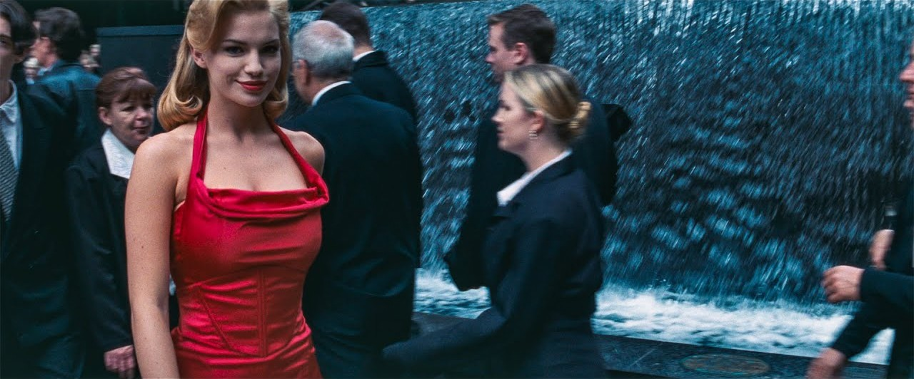
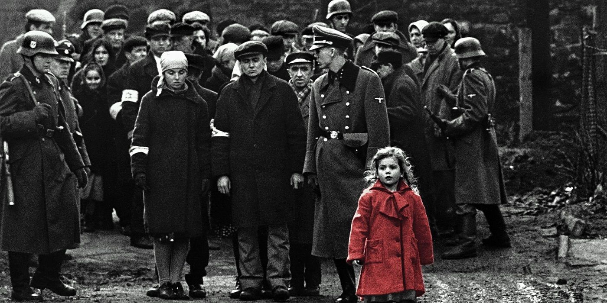
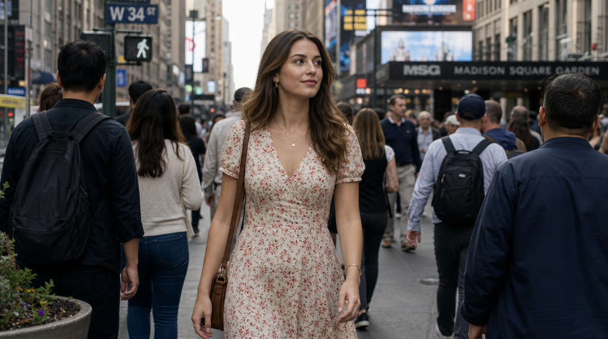
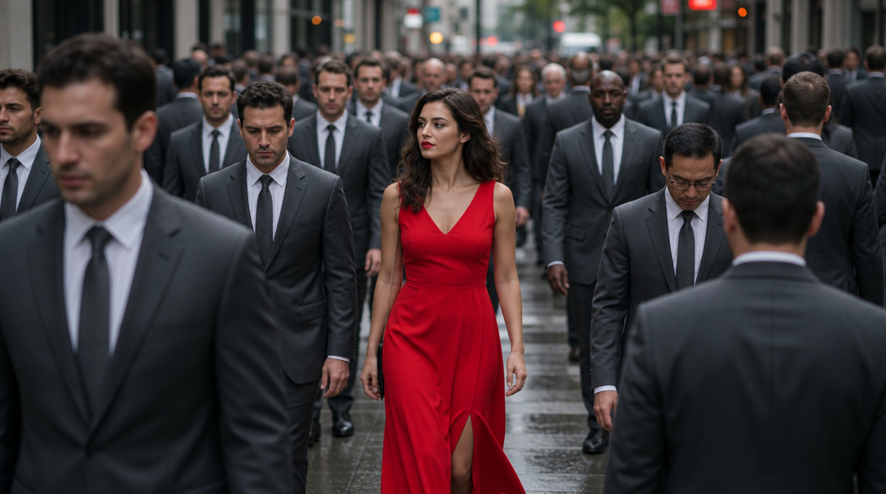
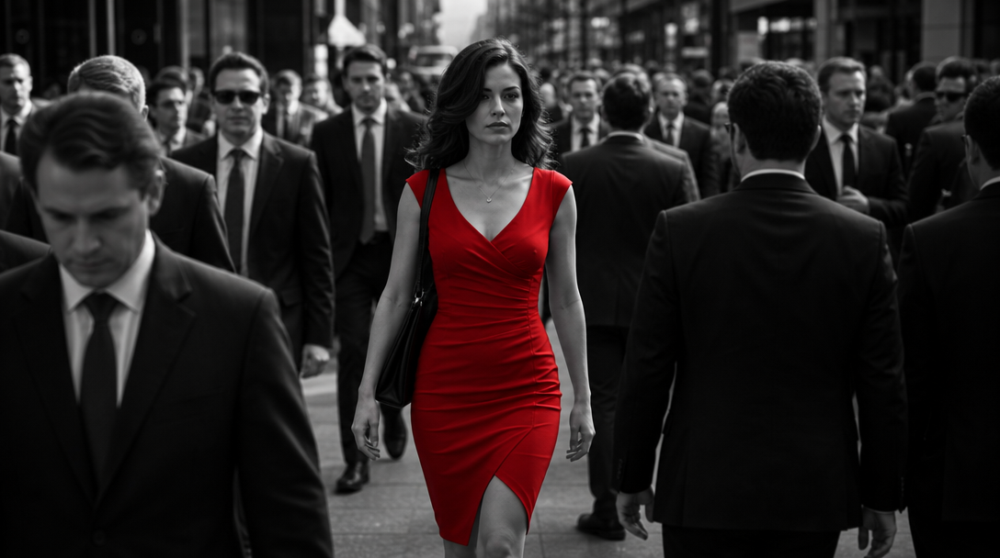
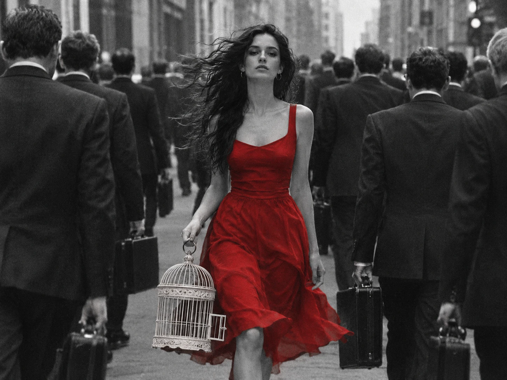

# Make one thing pop



You've probably seen this shot. Neo is walking through a crowd of people in dark suits, and then *she* appears. You remember her even if you've forgotten everything else in the scene.

**Color steers attention.** The eye goes straight to whatever is different.

The trick is simple: everyone is dark and alike, and she is red. The crowd turns into a background, almost one organism, and she is the only individual in it.

*Schindler's List* takes it a step further. The whole film is black and white, and one little girl wears a red coat. The world has no color, and she does. You can't look away from her.



Let's use this.

## Three steps, one frame

Click the image to step through, or pick a frame below. Only the prompt changes.

::::ladder
:::step{label="Default"}
```prompt
A woman in a dress walking through a crowded city street.
```


:::

:::step{label="Contrast"}
```prompt
A woman in a bright red dress walking through a crowded city street. Everyone around her wears identical dark grey suits.
```


:::

:::step{label="Selective color"}
```prompt
Black-and-white photograph with selective color: a woman in a bright red dress walking through a crowded city street, everyone around her in dark suits. The red dress is the only color in the frame.
```


:::
::::

:goto[00 Default]{step=0} The first frame is what most people would type. It isn't *bad*. It's fine. It's also exactly what everyone else gets: a pretty woman, a busy street, a floral dress, people dressed in every color. Nothing tells your eye where to look. This is the default, and the default is what makes slop look like slop.

:goto[01 Contrast]{step=1} One extra sentence makes her different from everyone around her. The crowd becomes a uniform mass, and she's the only person who isn't part of it. You see her before you see anything else. Look at the background, though: red traffic lights, orange signs. They compete with her a little. The AI kept the city's colors because we never told it not to.

> **How you phrase it matters.** Notice that we described the *whole frame* first ("black-and-white photograph") and then named the one exception ("the red dress is the only color"). Telling a model what *not* to do ("everything else must not be colored") works worse, because models often miss exclusions.

:goto[02 Selective color]{step=2} So we take the color away from everything except her, and now there's nothing else to look at. This technique has a name: **selective color**. Remember the name. It's your vocabulary now, and models understand it too.

## Your turn

Pick your own subject. It doesn't have to be a person or a street. A yellow umbrella in a grey rain, a single lit window in a dark building, a red apple in a pile of green ones.

1. **Intent first.** In one line, write what you want the viewer to feel. *"She doesn't belong here."* *"Hope in a gloomy place."*
2. **Prompt it.** Start with the default, then add contrast, then try selective color.
3. **Compare** your result with your own default.

<div class="try">

**Try it in any image generator.** The built-in generator is coming. Until then, [arena.ai](https://arena.ai) has a small free daily quota.

</div>

**Check your result:**
- Where does your eye land first? Is it the thing you wanted?
- Does anything else in the frame compete for attention?
- Does the contrast *mean* something, or is it just color?

## When the AI surprises you

Your result probably won't be exactly what you asked for. Sometimes a stray color slips in; in one of our attempts, the AI quietly made her lips red. Sometimes it's annoying. Sometimes it's a gift: an idea you didn't have, which you can keep and build on.

AI can be a co-creator, even by accident. But **you** decide what stays.

## Director's cut

Here's what happens when you keep going. Every extra detail below serves the same idea as the color: *she is not like the others.*

```prompt
Candid black-and-white street photograph on 35mm film, visible grain, with selective color: a woman with long dark hair in a bright red dress walks calmly toward the camera, carrying an antique white birdcage by its ring at her side, the cage empty and its little door hanging open, her hair and dress moving in the wind, against the flow of a dense crowd of men in identical dark suits with briefcases hurrying away from us. She is the only one looking into the lens. The red dress is the only color in the frame.
```



What each addition does:

- **She walks toward us, and they walk away.** Moving against the flow is another way of being different. *(Composition)*
- **An empty birdcage, among the briefcases.** It hangs at the same height as theirs, so your eye compares them: freedom against routine. And it raises a question: where's the bird? *(Specific subject)*
- **Hair and dress in the wind.** She is alive and moving; they are rigid. *(Specific subject)*
- **She looks into the lens.** She's the only one who notices *you*. *(Composition)*
- **35mm film, visible grain, candid.** This removes the glossy "AI look". *(Film stock)*

We'll go deeper into each of these in later lessons. The point for now: **details work when they serve your intent.** Random details just add noise.

## Where this is heading

The same image, brought to life:

<!-- video: media/5-teaser.mp4 -->


Images are where you practice: they're fast and cheap, and you can try dozens. Video is where you're heading. Get the frame right first, then make it move.

## Try next

- **Sepia** instead of black and white, for a vintage look.
- **Two colors, not one.** Does it still work, or does the effect disappear?
- **What if her hair matched the dress?** Does she stand out *more*, or does the image just get louder?
