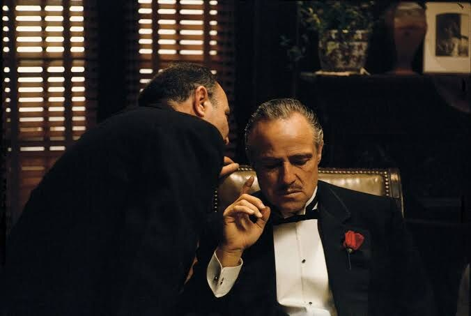
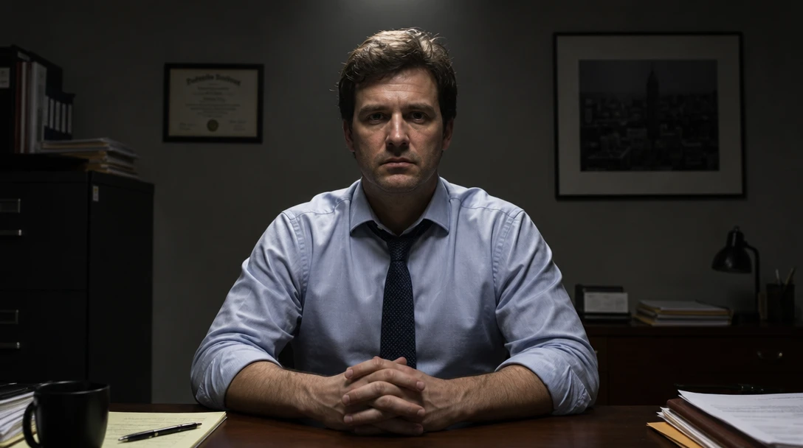
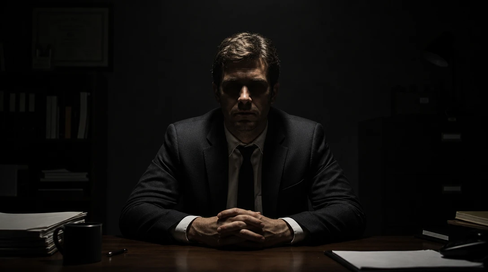
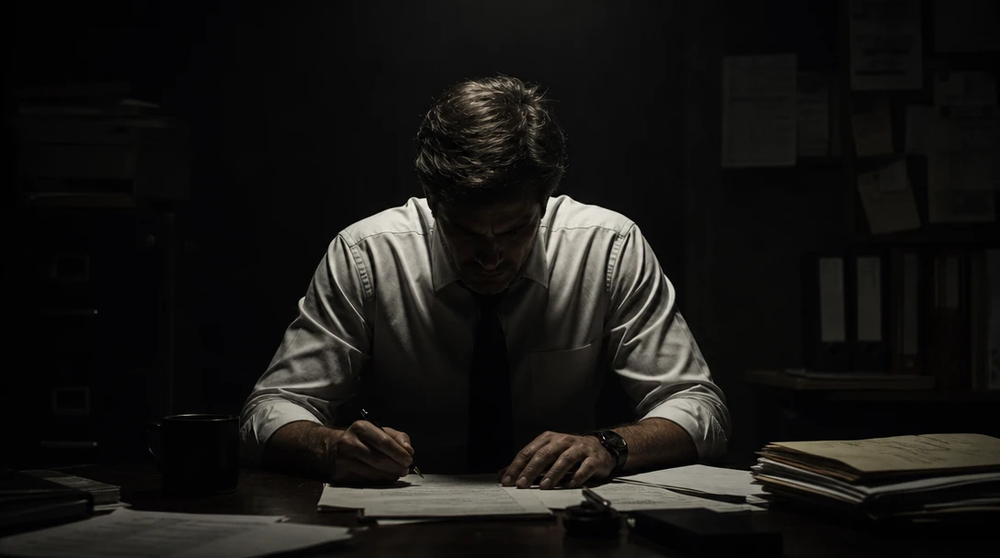
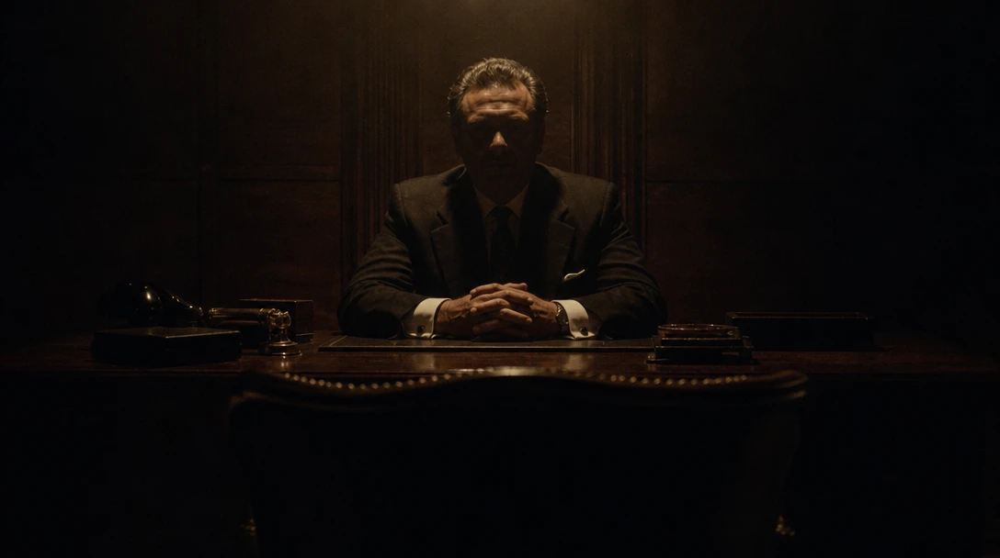

# Light from above



You know this man. A dark office, a whisper in his ear, a red rose on his lapel.

Look at the light. The room is almost black. Everything you see comes out of the darkness. The light falls **from above**: it sculpts his forehead, his nose and his cheekbones, and lets his eyes sink into shadow. You can't quite read him.

**Light decides what you see, and what you don't.** What stays in the dark is as important as what's lit.

The cinematographer, Gordon Willis, lit so dark that he was nicknamed "the Prince of Darkness". Let's borrow his trick.

## Three steps, one frame

Click the image to step through, or pick a frame below. Only the prompt changes.

::::ladder
:::step{label="Default"}
```prompt
A man sitting at a desk in his office, facing the camera.
```


:::

:::step{label="Top light"}
```prompt
A man sitting at a desk in his office, facing the camera, lit by a hard light from directly overhead, the source out of frame.
```


:::

:::step{label="Low-key"}
```prompt
A man sitting at a desk in a dark office, facing the camera, lit by a single hard light from directly overhead, the source out of frame. Low-key lighting: the room falls into deep shadow and his eyes are hidden in the shadow of his brow.
```


:::
::::

:goto[00 Default]{step=0} Bright, even light from everywhere. Nothing is hidden, so nothing is mysterious. It's a perfectly nice photo for a company website, and it's what everyone gets.

> **Describe the effect, not the lamp.** When we first wrote "lit by a light above him", the AI drew a lamp hanging in the frame. "The source out of frame" keeps the light while hiding the lamp.

:goto[01 Top light]{step=1} We say where the light comes from: above. Shadows appear under his brow and nose, and the room gets dimmer. The technique is called **top light**.

Notice something we didn't ask for: **he stopped smiling.** The AI read "hard light from above" as a *mood* and changed his face to match. AI treats your words as atmosphere, not just instructions. Sometimes that works for you; sometimes you'll have to push back.

:goto[02 Low-key]{step=2} Then we turn everything else off. The room disappears. Only he remains, and you can't see his eyes. Same man, same desk, and now he's dangerous. This is **low-key lighting**: most of the frame is dark, and the light is used sparingly.

## Same light, different story

Here's the same light again. We changed one thing: he's looking down at his papers.



He's not dangerous anymore. He's tired and alone, working late.

But wait, the Don is looking down too, and he doesn't seem lonely at all. He seems powerful. Why? Because of everything around him: a man pleading in his ear, the tuxedo, the rose. He doesn't even need to look up.

**The light sets the mood range: drama, secrets, darkness. The subject and the context decide which story you get.** Light alone won't make your image mean something. You decide what it means.

## Your turn

Pick a subject of your own: a person, an animal, an object. A cat on a windowsill, an old pair of boots, a kid with a flashlight.

1. **Intent first.** In one line: what should the viewer feel? *"Something's hidden here."* *"Alone at night."*
2. **Prompt it.** Start with the default. Then move the light above. Then let the dark in.
3. **Try one pose change**, and see how the story changes under the same light.

<div class="try">

**Try it in any image generator.** The built-in generator is coming. Until then, [arena.ai](https://arena.ai) has a small free daily quota.

</div>

**Check your result:**
- What's hidden in your image? Is that what you wanted to hide?
- Where does the light fall first? Does your eye go there?
- Does the pose fit the mood, or fight it?

## Director's cut

Here's our take: not a copy of the film, but the same principle pushed further. Every detail serves one idea: *he has power, and you don't know what he's thinking.*

```prompt
Film still on 35mm, heavy grain, warm amber tones. Low-key lighting: a single hard light from directly overhead, the source out of frame, on a middle-aged man in a dark suit sitting behind a heavy wooden desk in a dark, wood-paneled office, facing the camera. His eyes are hidden in the deep shadow of his brow; his face is unreadable. His hands are folded on the desk, fully lit. Low angle, the camera slightly below his eye level, so he looms over us. In the foreground, the back of an empty chair faces him across the desk, in silhouette. Everything outside the pool of light falls into near-black.
```



What each addition does:

- **Hands lit, face in shadow.** You see what he can *do*, not what he *thinks*. *(Light)*
- **An empty chair facing him.** It's your seat. You're the one who came to ask for something. *(Composition)*
- **Symmetry.** He sits dead center, and the room is arranged around him. *(Composition)*
- **Warm amber tones.** Half of the film's mood is its color. Grey would feel colder and more modern. *(Color)*
- **35mm, heavy grain.** It looks like a film from the 70s, not a render. *(Film stock)*

## Where this is heading


The light never moves. He does. In a still, his eyes are hidden. In a video, you can choose the moment they appear. That's what we'll learn later: light that changes over time.

## Try next

- **Light from below**, like a flashlight under the chin. What happens to the mood?
- **Light from the side**, so half the face is in shadow. Who is this person now?
- **High-key:** the opposite of low-key. Bright, white, almost no shadows. When would you want that?
