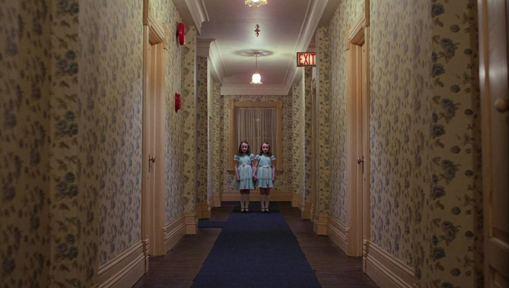
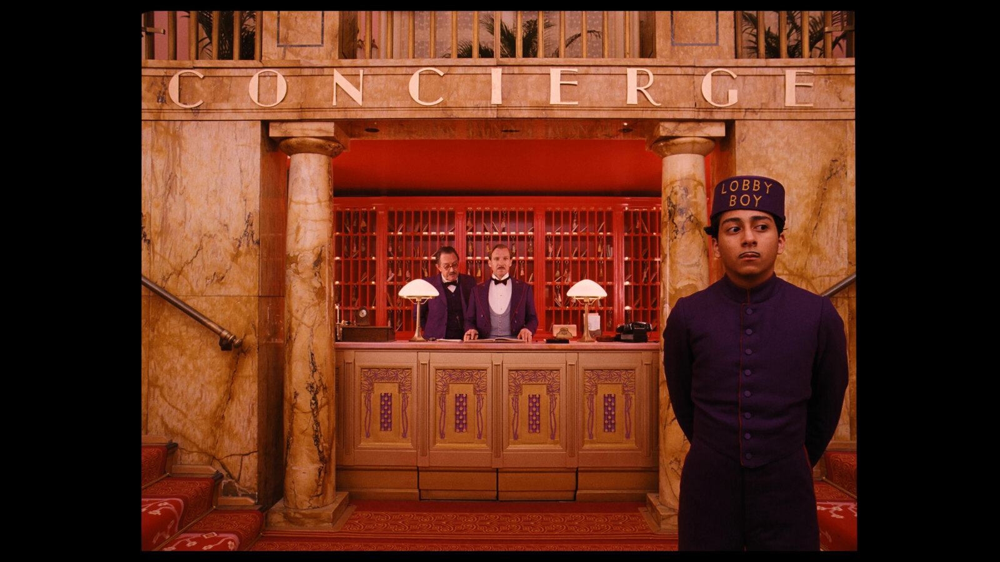
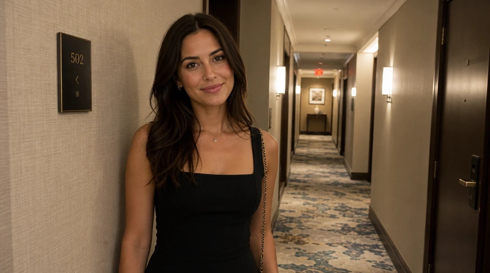
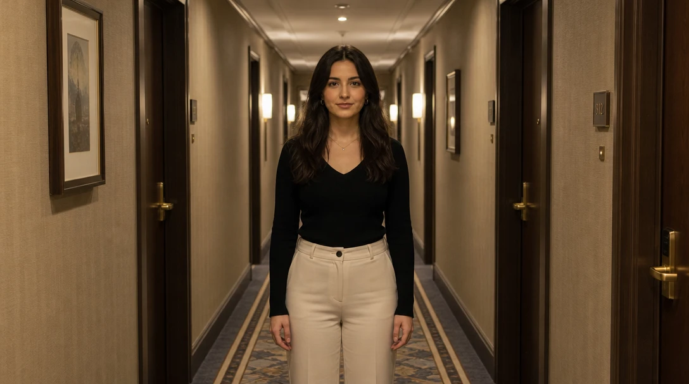
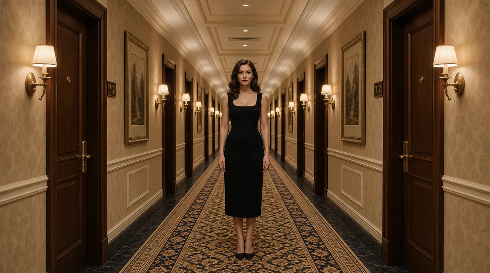
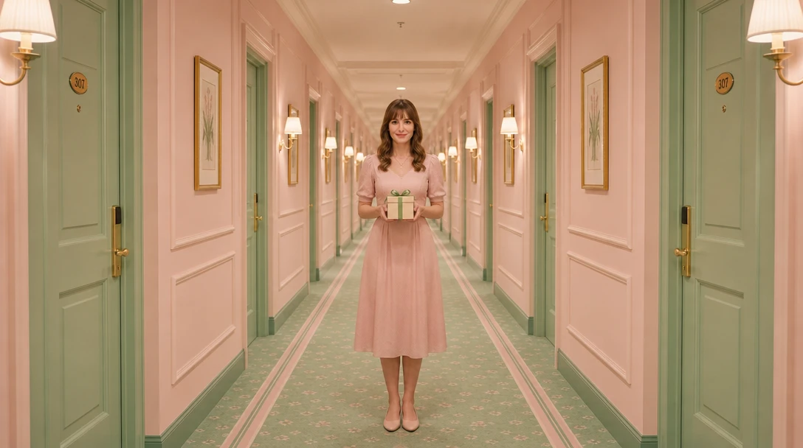
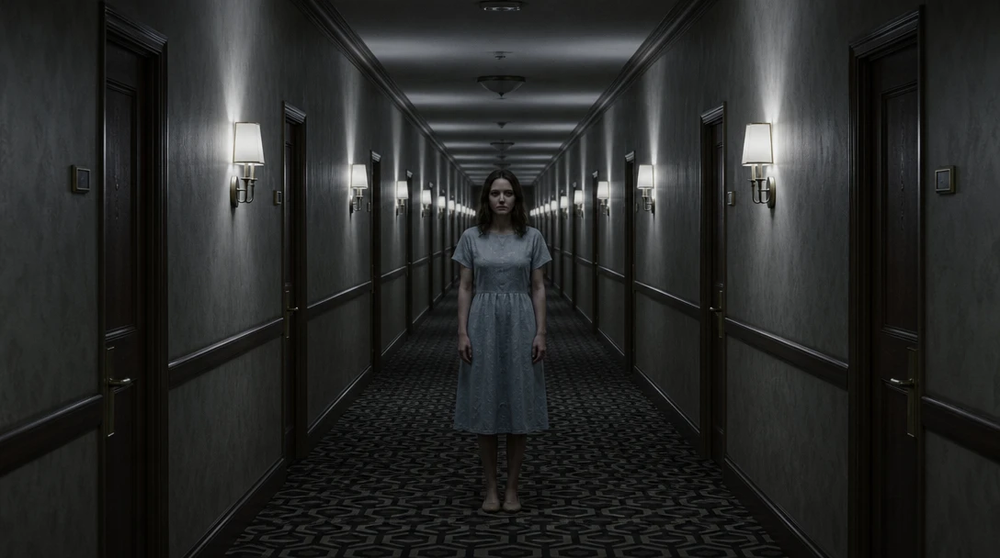
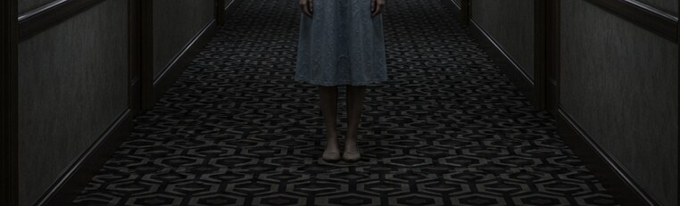
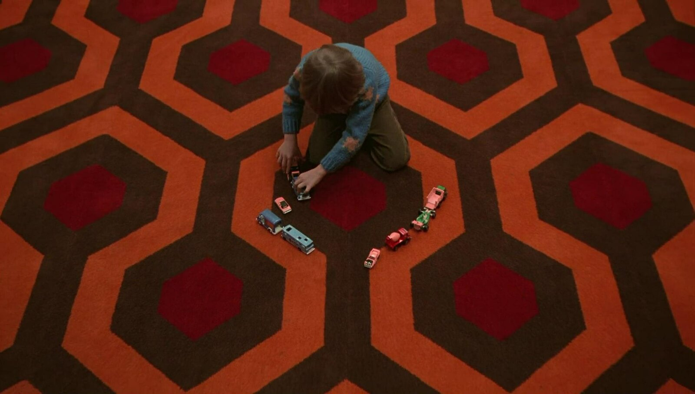
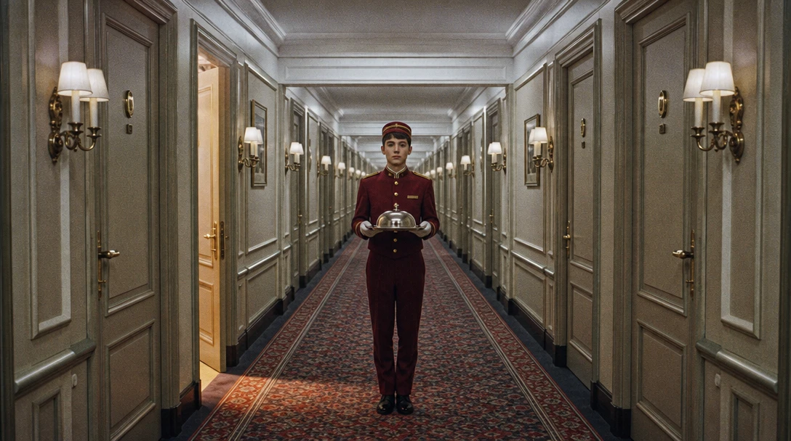

# Perfect order



A hotel corridor. Two girls in identical dresses stand side by side at the far end, perfectly still. Every line in the frame, the walls, the doors, the carpet runner, runs straight toward them. Nothing is out of place, and that's what makes it unbearable.

Real life is never this neat. When a frame is *perfectly* ordered, you feel that someone arranged it, and you start wondering why.

**Symmetry makes a frame feel deliberate.** The eye goes straight to the center, and stays there.

*The Grand Budapest Hotel* uses the same order for the opposite feeling. The concierge desk sits dead center between two columns, "CONCIERGE" is spelled out above it, and a lobby boy stands in front, stiff as a toy soldier. Same rule, a warm and funny world.



Let's try it.

## Three steps, one frame

Click the image to step through, or pick a frame below. Only the prompt changes.

::::ladder
:::step{label="Default"}
```prompt
A woman standing in a hotel hallway.
```


:::

:::step{label="Centered"}
```prompt
A woman standing in a hotel hallway, in the exact center of the frame, facing the camera straight on.
```


:::

:::step{label="Symmetry"}
```prompt
Perfectly symmetrical one-point perspective shot of a long hotel hallway: the camera is at eye level, looking straight down the middle. The walls, doors and wall lamps on the left mirror the ones on the right exactly, and every line runs toward a single vanishing point at the far end. A woman stands in the exact center of the frame, facing the camera straight on.
```


:::
::::

:goto[00 Default]{step=0} A friendly selfie. She's off to the left, leaning on the wall, smiling at us. The hallway is just a background running off to the side. Nothing's wrong with it, and nothing's interesting either.

:goto[01 Centered]{step=1} Put her in the middle, facing us, and the picture becomes a portrait. It's already calmer and more formal. But we only see her from the waist up, and the hallway is still just a backdrop.

:goto[02 Symmetry]{step=2} Now the whole frame is built around her. The left side mirrors the right, the lamps repeat into the distance, and every line runs to a point right behind her. She's smaller than before, but she's impossible to miss. Two terms to keep:

- **Symmetry**: the left half of the frame mirrors the right.
- **One-point perspective**: the camera looks straight down a corridor, a road, or a row of trees, so all the lines meet at a single point. Put your subject on that point, and every line in the picture points at them.

## Same order, different story

Same prompt, same composition. We added one sentence each time: the light, the colors, and her pose.

::::ladder
:::step{label="Cozy"}
```prompt
Perfectly symmetrical one-point perspective shot of a long hotel hallway: the camera is at eye level, looking straight down the middle. The walls, doors and wall lamps on the left mirror the ones on the right exactly, and every line runs toward a single vanishing point at the far end. A woman stands in the exact center of the frame, facing the camera straight on. Soft warm daylight, pastel pink walls and a mint-green carpet; she smiles slightly, holding a small wrapped gift in both hands.
```


:::

:::step{label="Creepy"}
```prompt
Perfectly symmetrical one-point perspective shot of a long hotel hallway: the camera is at eye level, looking straight down the middle. The walls, doors and wall lamps on the left mirror the ones on the right exactly, and every line runs toward a single vanishing point at the far end. A woman stands in the exact center of the frame, facing the camera straight on. Dim, cold light; the hallway stretches far into darkness behind her, the carpet is a dark repeating geometric pattern; she stands perfectly still, arms at her sides, staring into the lens without expression.
```


:::
::::

The pink one could be a scene from a comedy. In the dark one, you don't want to walk down that hallway.

**Symmetry doesn't choose the mood. It makes whatever mood you choose feel intentional.** Warm and soft, it's charming, like a dollhouse. Cold and still, the same perfection feels unnatural: too neat to be safe.

## When the AI surprises you

For the creepy version, we only asked for "a dark repeating geometric pattern" on the carpet. Look at what we got:



Interlocking hexagons. Here's the carpet from *The Shining*:



Same pattern, just grey instead of orange. We never mentioned the film. "Symmetrical hotel corridor" + "creepy" was enough for the AI to reach for it.

That's how AI works: it has seen the classics, and it falls back on the most famous version of whatever you describe. Sometimes that's a gift. Sometimes it means your image looks like a copy. Notice when it happens, and decide whether you want it.

## Your turn

Find a place with a natural center line: a corridor, a road, a bridge, a church aisle, a row of trees, a subway platform.

1. **Intent first.** In one line: *"Calm and perfect."* *"Too perfect."* *"Trapped."*
2. **Prompt it.** Start with the default. Then put your subject dead center. Then make the whole frame mirror itself.
3. **Add one sentence** of light and color, and see which way it tips the mood.

<div class="try">

**Try it in any image generator.** The built-in generator is coming. Until then, [arena.ai](https://arena.ai) has a small free daily quota.

</div>

**Check your result:**
- Fold the image in half in your head. Do the two sides match?
- Where do the lines meet? Is your subject right there?
- Does the order feel charming or unsettling? Is that what you meant?

## Director's cut

Every addition serves one idea: *everything here is perfect, and one thing is out of place.*

```prompt
Film still on 35mm, visible grain. Perfectly symmetrical one-point perspective shot of a long, empty grand hotel hallway, the camera at eye level looking straight down the middle: identical doors, identical brass wall lamps and a patterned carpet mirror each other left and right, every line running to a single vanishing point at the far end. A young bellhop in a crimson uniform stands at attention in the exact center of the frame, holding a silver room-service tray with one covered dish, looking straight into the lens. Every door is closed except one on the left, which stands slightly ajar, warm light spilling out across the carpet. Soft, even, slightly cold light.
```



What each addition does:

- **One open door.** The only thing that breaks the symmetry, so it's the first thing you look for after him. Who's in there? Is the tray for them? *(Composition: breaking the pattern)*
- **A covered dish.** You can't see what's under it. A small question in the middle of the frame. *(Specific subject)*
- **The crimson uniform.** The only strong color in a pale corridor, so he pops. *(Color: lesson 1)*
- **At attention, looking at us.** He's waiting. For you? *(Specific subject)*
- **Even, slightly cold light.** Not scary, not cozy: a hotel at 3 a.m. *(Light)*

## Where this is heading

<!-- TODO: video teaser, image-to-video from media/5-directors-cut.webp. Idea: locked-off camera, perfect symmetry held; nothing moves except the open door, which slowly swings a little wider, or the light inside it flickers. The bellhop doesn't blink. Generate after the still is approved. -->

In a still, the symmetry is perfect. In a video, you can hold it perfectly still, and then let one small thing move.

## Try next

- **Break the symmetry on purpose**: keep everything mirrored, but move your subject a little off-center. What does that tension feel like?
- **Look down instead of ahead**: a perfectly symmetrical shot from directly above (a pool, a dinner table, a staircase).
- **Two subjects**, one on each side of the center line. Are they a pair, or opponents?
