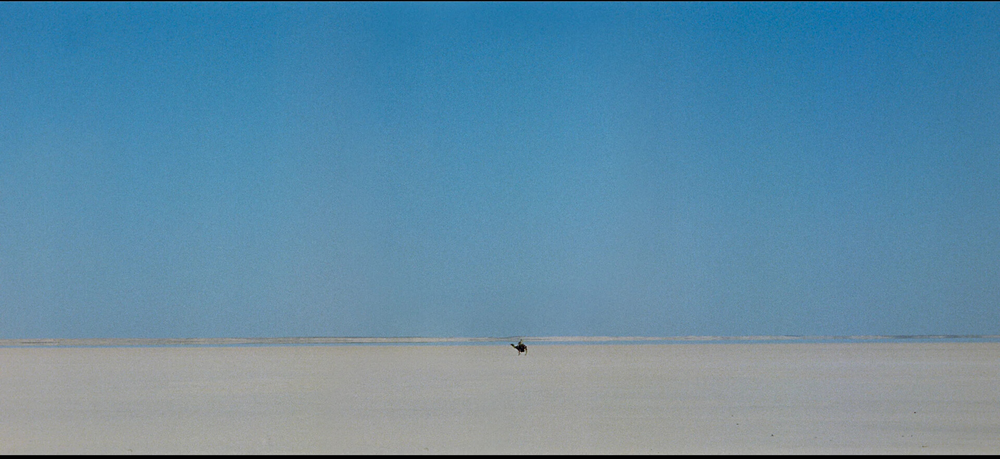
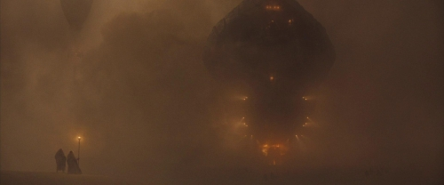
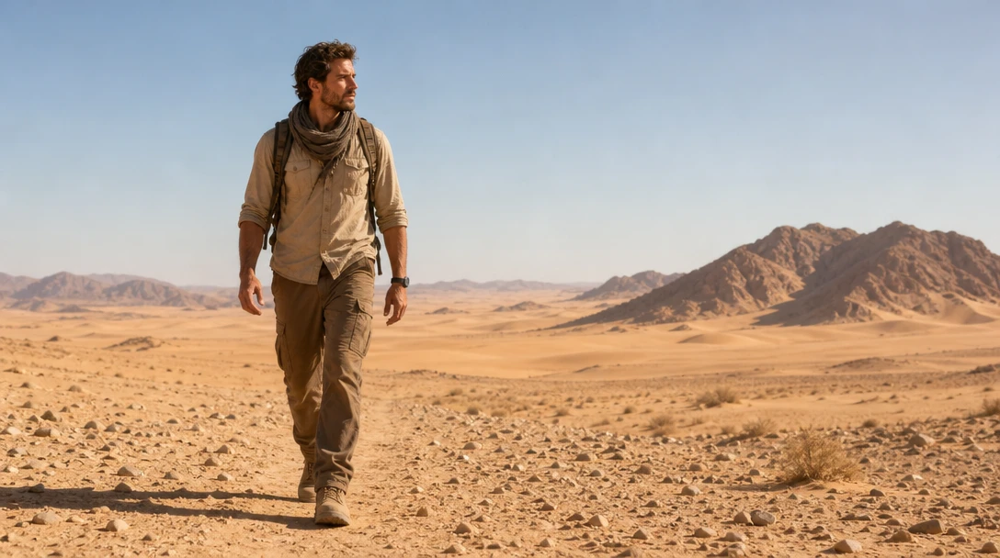
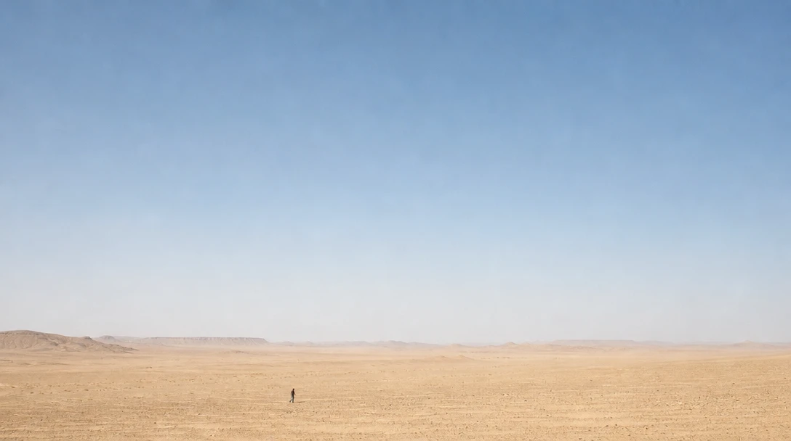
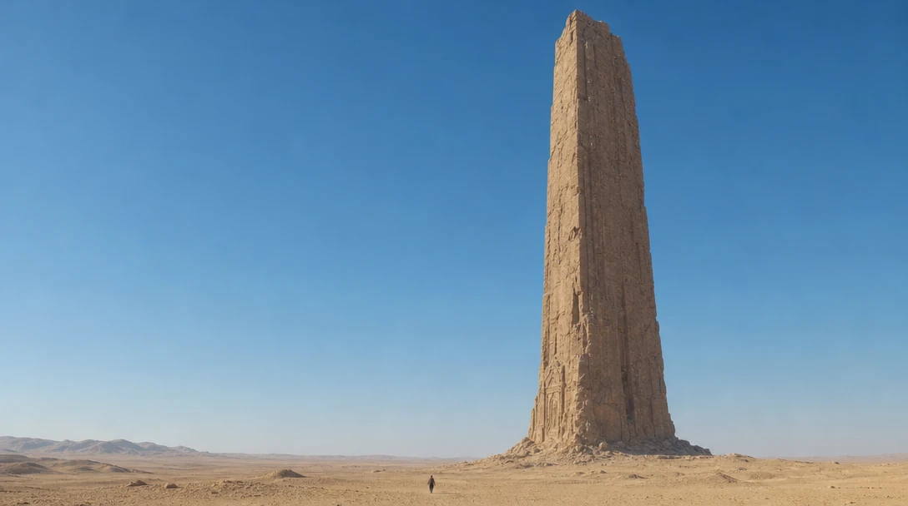
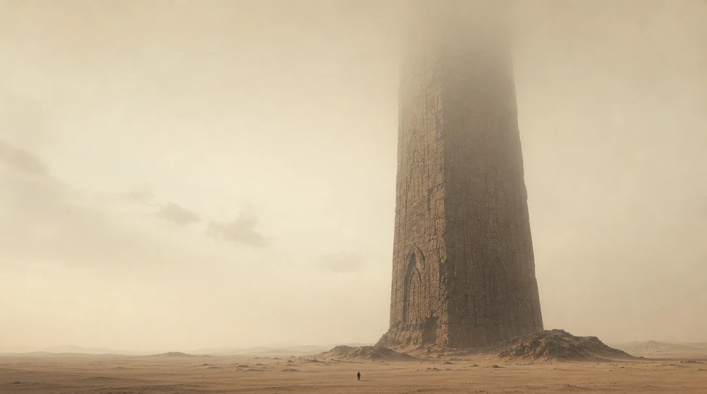
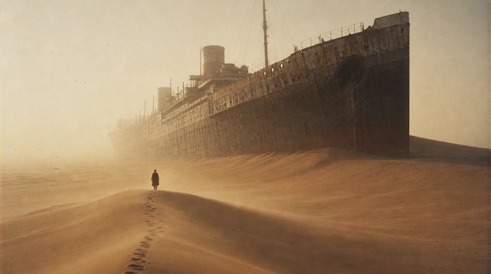

# Small in a big world



A lone rider on an endless salt flat. He is a speck. Almost the entire frame is sky and emptiness.

You'd think the person should be big: they're the subject. But here the emptiness *is* the subject. You feel how far he has to go, and how alone he is.

**How big your subject is in the frame changes how it feels.** Make it small, and the world around it starts telling the story.

*Dune* uses smallness differently. Its people are tiny next to something *enormous*. We'll try both.



## Three steps, one frame

Click the image to step through, or pick a frame below. Only the prompt changes.

::::ladder
:::step{label="Default"}
```prompt
A man walking through the desert.
```


:::

:::step{label="Extreme wide"}
```prompt
Extreme wide shot of a man walking through the desert: he is a tiny figure near the bottom of the frame, and empty sand and sky fill almost everything else.
```


:::

:::step{label="Scale reference"}
```prompt
Extreme wide shot of a man walking through the desert under a clear sky: he is a tiny figure near the bottom of the frame. Beside him, an enormous ancient stone monolith rises out of the sand, hundreds of times his height, reaching almost to the top of the frame.
```


:::
::::

:goto[00 Default]{step=0} A handsome adventurer with a backpack, filling half the frame. It looks like an ad for hiking boots. AI almost always does this: the subject is big and in the middle, because you said it's the subject.

:goto[01 Extreme wide]{step=1} Now he's a dot, and the desert is endless. Same man, same desert, and suddenly you feel the distance, the heat, the loneliness. Two terms to keep:

- **Extreme wide shot**: the camera is so far away that the subject becomes tiny.
- **Negative space**: the empty part of the frame. It isn't wasted. It's what makes him feel small.

:goto[02 Scale reference]{step=2} The *Dune* way: give his smallness something to be measured against. He's just as small as before, but now your eye has something to compare him with, and the feeling changes: not *alone* anymore, but *overwhelmed*. In an empty desert, you can't tell how big anything is. Next to the monolith, you can.

**Same size, different story.** Emptiness says *loneliness* or *freedom*. Something huge says *awe* or *threat*. The space around your subject decides which one.

## When the AI surprises you

In our first attempt, we wrote that the monolith's top was "fading into the haze". The AI didn't just add haze at the top. It filled the whole sky with it:



We didn't ask for that, and it changed two things at once. But look: the haze hides where the tower ends, so it feels endless. Sometimes the "mistake" is the better picture. You decide.

## Your turn

Pick something small and something big. A cat in an empty stadium, a lighthouse on a huge cliff, a child at the foot of a giant tree.

1. **Intent first.** In one line: *"Lost."* *"Free."* *"Tiny against something ancient."*
2. **Prompt it.** Start with the default. Then make your subject small. Then decide: emptiness, or something huge?
3. **Compare** your three images.

::generator

**Check your result:**
- Can you still find your subject in a second? If not, does it stand out enough (color, contrast, position)?
- What does the empty space say? Is that what you meant?
- If there's something huge, does it make your subject feel small, or does it just take over?

## Director's cut

Every addition serves one idea: *a lone traveler, and a mystery far bigger than him.*

```prompt
Film still on 35mm, visible grain, warm hazy morning light. Extreme wide shot: a tiny lone figure in a long dark coat walks along the crest of a dune toward the rusted hull of a colossal ocean ship stranded in the middle of the desert, half-buried in sand, hundreds of times his height, its bow fading into the haze. A single line of footprints trails behind him across the dunes. Wind lifts a thin veil of sand off the crest. No sea anywhere in sight. The figure is the only living thing in the frame.
```



What each addition does:

- **An ocean ship in the desert.** Enormous, and impossible. Where is the sea? The image asks a question. *(Specific subject)*
- **A line of footprints.** It shows how far he has come, and it leads your eye from the bottom of the frame to him and then to the ship. *(Composition: leading lines)*
- **He walks *toward* it.** He has a goal. Without that, he's just standing in a landscape. *(Composition)*
- **Sand blowing off the crest.** The world is alive, and a little hostile. *(Specific subject)*
- **Warm haze, 35mm grain.** The haze adds depth and hides the ship's far end. *(Light, Film stock)*

## Where this is heading


In a still, he's small. In a video, he can keep getting smaller: the camera rises, the world grows, and he walks on.

## Try next

- **The opposite end: extreme close-up.** Fill the whole frame with just the eyes. How does that feel compared with the dot in the desert?
- **Put the subject on the edge** of the frame instead of the bottom. Where does the empty space push your eye?
- **Make the huge thing alive**: a whale, a giant, a storm. Does awe turn into fear?
