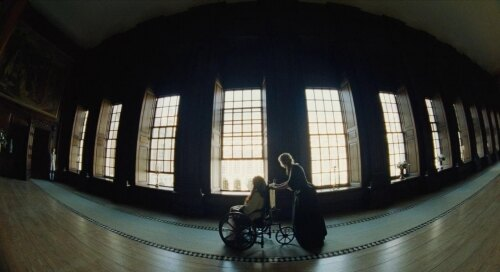
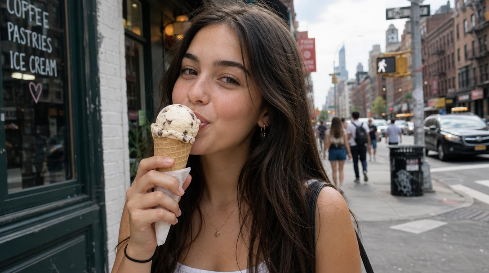
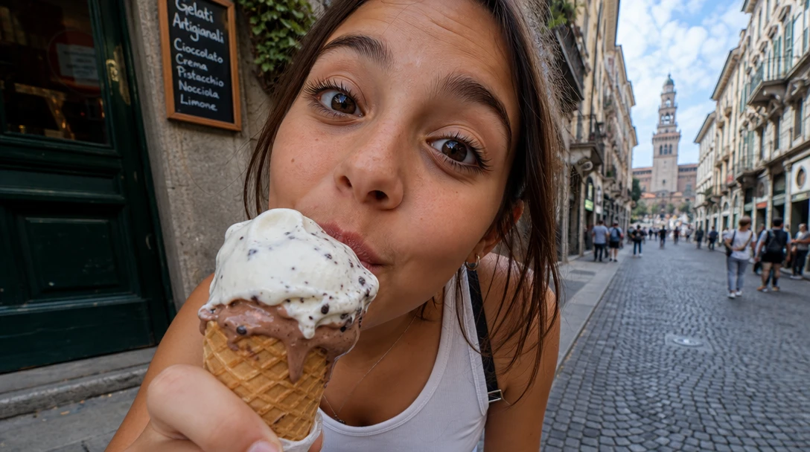
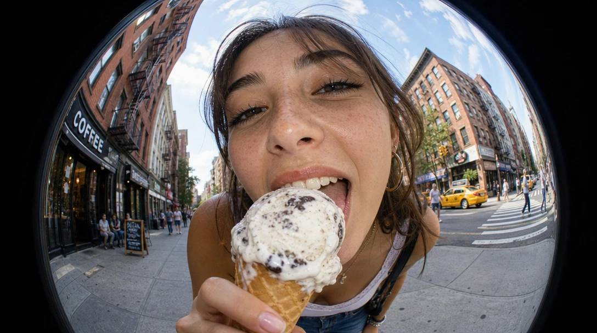
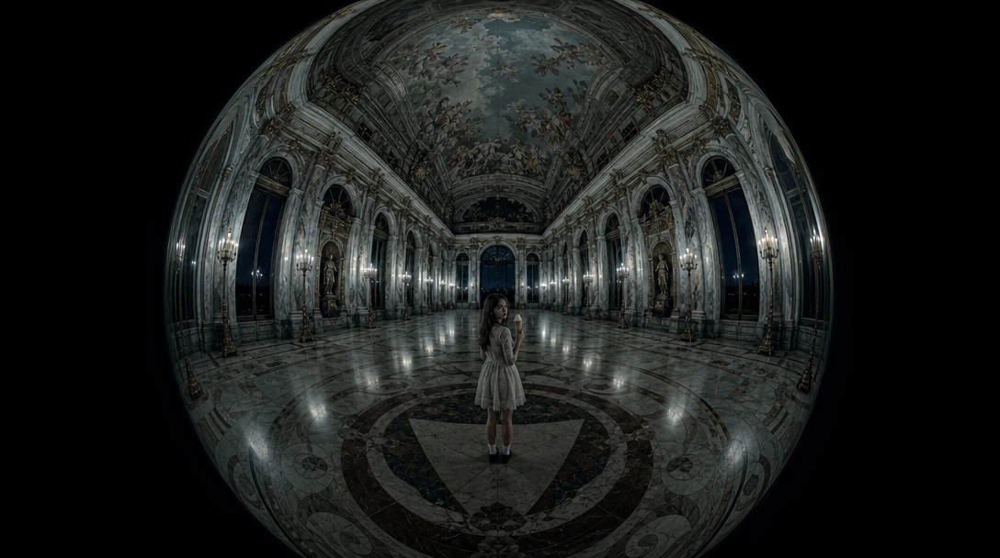
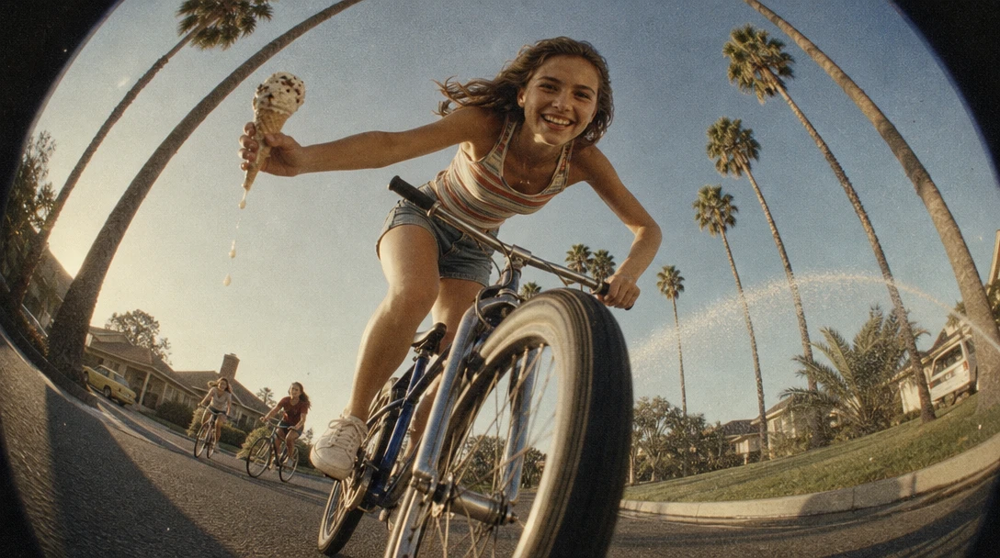

# Bend the world



A long palace gallery seen through a fisheye lens. Someone in a wheelchair is pushed past a row of tall windows. The floor curves, the windows lean, the ceiling bows overhead, and the two figures look small inside a room that bends around them. It feels like someone is watching through a peephole.

Now think of a 90s skate video. Same lens, pushed right up to a skater's face, the board almost hitting the camera. It feels wild and fun.

**The lens decides how the world bends.** Every photo is taken through some kind of glass, and the glass changes the shape of everything. Most AI images use a "normal" lens, the one that bends nothing. That's part of why they feel so flat.

Let's bend something.

## Three steps, one frame

Click the image to step through, or pick a frame below. Only the prompt changes.

::::ladder
:::step{label="Default"}
```prompt
A girl eating ice cream on a city street.
```


:::

:::step{label="Wide angle up close"}
```prompt
Wide-angle lens shot from very close: a girl eating ice cream on a city street leans toward the camera, her face and the ice cream big in the foreground, the street stretching away small behind her.
```


:::

:::step{label="Fisheye"}
```prompt
Fisheye lens shot from very close, the whole image bulging in a round, curved frame: a girl eating ice cream on a city street leans toward the camera, her face and the ice cream huge in the center, the street and the buildings behind her bending around her in a curve.
```


:::
::::

:goto[00 Default]{step=0} A stock photo. Nice light, nice smile, and a lens that bends nothing. You've seen this picture a thousand times.

:goto[01 Wide angle up close]{step=1} A wide-angle lens, very close. Whatever is near the camera gets huge, and whatever is far gets tiny. The ice cream is as big as the street behind her. Even her nose looks bigger. That's why portrait photographers avoid this lens, and why it's so good when you want energy and closeness.

:goto[02 Fisheye]{step=2} Push it to the extreme. A fisheye sees almost everything around it, and to fit it all in, it bends every straight line into a curve. The buildings bow around her, the street wraps around the edge. She's the center of her own little planet. Two terms to keep:

- **Wide-angle lens**: sees more than your eye does. Close up, it makes near things huge and far things tiny.
- **Fisheye lens**: the widest of all. It bends straight lines into curves, and the world bulges around the center.

## Same lens, different story

Same lens. We moved her away from the camera, put her alone in a huge, empty hall, and turned the light cold.



The fun is gone. Up close, the fisheye was a party: it pulled her toward us. From far away, the same curve closes the room over her like a dome. She's small, and the walls seem to lean in.

**The lens sets how the world bends. How close you are decides the story.** Close up, a fisheye feels playful and loud. From a distance, it feels like being watched.

## When the AI surprises you

We asked for "a round, curved frame". We meant that the image bulges. The AI took it literally: it drew a **circle** of image surrounded by black.

That's a real kind of lens too: a **circular fisheye**, the extreme version, where the lens sees so much that the picture doesn't even fill the rectangle. The more common kind fills the whole frame and only curves the edges. It's called a *full-frame fisheye*.

We kept the circle, because it looks like peeking through a hole. If you want the edges filled, say "full-frame fisheye".

## Your turn

Pick something you can get very close to: a dog sniffing the lens, a kid with a water gun, a cat in a cardboard box, someone handing you a slice of pizza.

1. **Intent first.** In one line: *"In your face."* *"Wild fun."* *"Trapped."*
2. **Prompt it.** Start with the default. Then switch to a wide angle, up close. Then go full fisheye.
3. **Move the camera back** with the same lens, and see how the mood flips.

<div class="try">

**Try it in any image generator.** The built-in generator is coming. Until then, [arena.ai](https://arena.ai) has a small free daily quota.

</div>

**Check your result:**
- Which lines curve? Do they curve around your subject, or away from it?
- What's closest to the lens? It will be the biggest thing in the frame. Is that what you want to be biggest?
- Does the distortion feel fun, or unsettling? Is that what you meant?

## Director's cut

Every addition serves one idea: *the best day of summer, and nothing can stop her.*

```prompt
Shot on 16mm film, visible grain, warm late-afternoon summer sun. Fisheye lens from very low and very close: a teenage girl on a bicycle leans into a turn right over the camera, grinning at the lens, one hand off the handlebars holding a dripping ice-cream cone, her front wheel huge in the foreground. Behind her the whole suburban street curves up and around like a bowl: houses, a row of tall palm trees bending inward, a lawn sprinkler throwing an arc of water that catches the sun. Her two friends on bikes chase behind her, small and far.
```



What each addition does:

- **Low and close.** The front wheel is almost hitting us, and she rides over the camera. We're in the middle of it. *(Camera)*
- **Palm trees bending inward.** Tall straight lines show the fisheye best. They curve over her like the street is cheering. *(Lens)*
- **A dripping cone, one hand off the handlebars.** A little reckless, and very summer. *(Specific subject)*
- **Friends chasing her.** She's winning. *(Composition)*
- **16mm, warm late sun.** A home movie from a summer you remember, not a render. *(Film stock, Light)*

## Where this is heading

<!-- TODO: video teaser, image-to-video from media/4-directors-cut.webp. Idea: the camera rides alongside her, low to the ground; she sweeps past the lens, the curved street rolls by, the sprinkler arc glitters, her friends catch up. Generate after the still is approved. -->

In a still, the street is curved. In a video, a fisheye that moves makes the whole world roll around you. That's why skate videos love it.

## Try next

- **The opposite lens: telephoto.** Shoot from far away with a long lens. Instead of stretching distance, it squashes it: a huge moon right behind a tiny figure.
- **Fisheye from above**, looking straight down at a crowd or a dinner table. What happens to the edges?
- **A full-frame fisheye** instead of the circle. Does it feel less like peeking?
