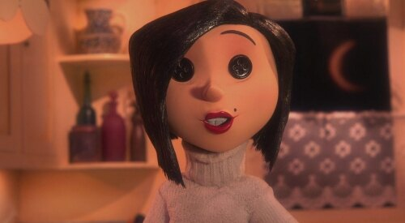
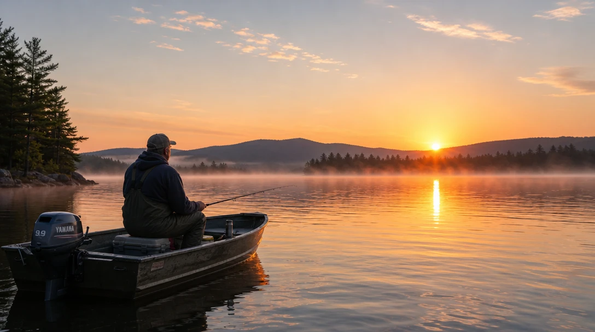
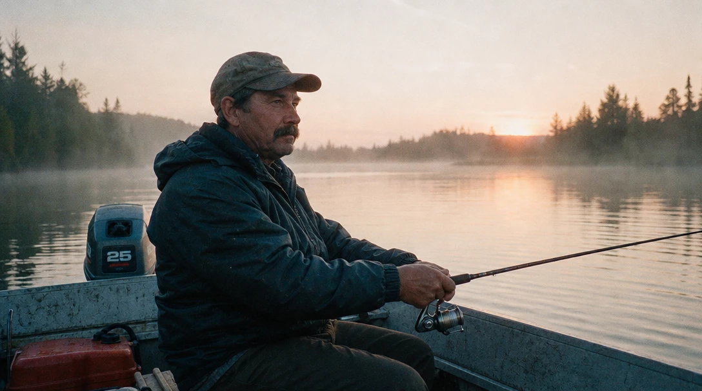
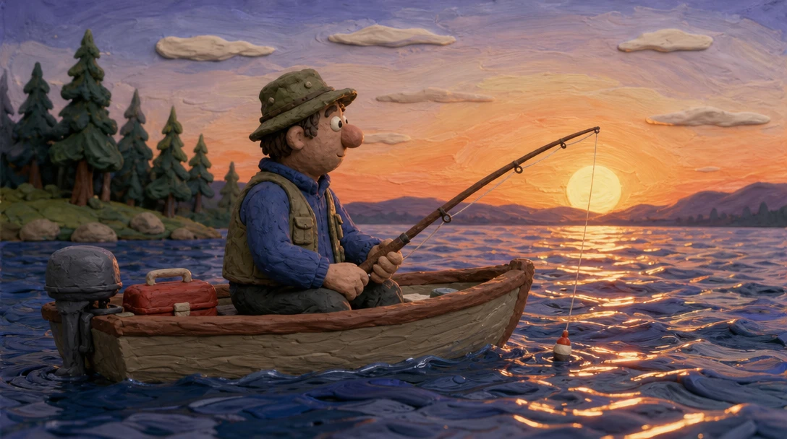
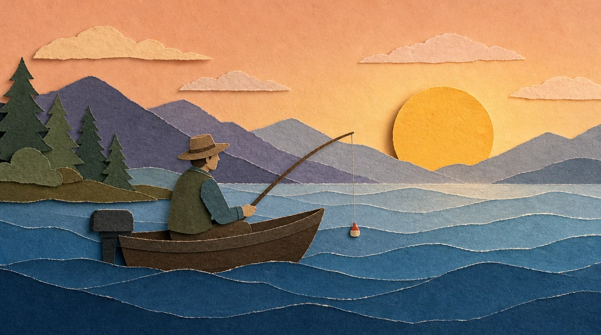
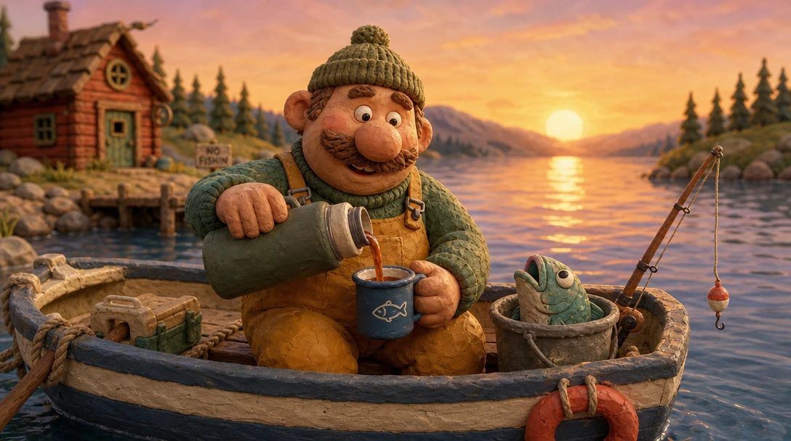
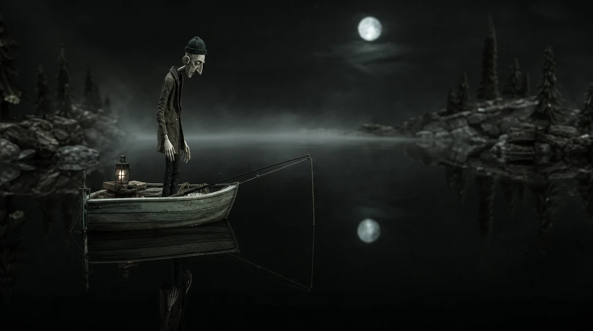
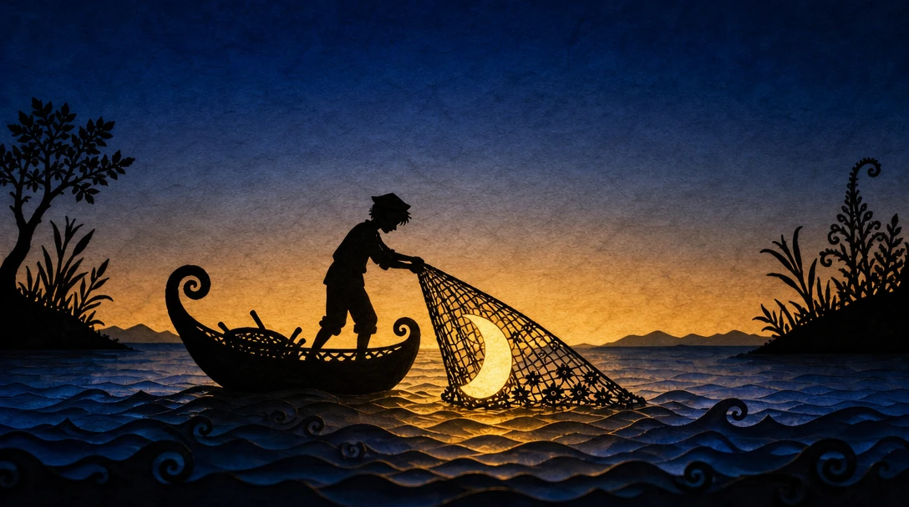

# Not a render



A woman smiles at you in a warm kitchen. Her hair is neat, her lipstick is perfect, and her eyes are two black buttons.

Every bit of this was made by hand: a puppet, a tiny kitchen, real fabric, moved a fraction of an inch at a time. That's part of why it's so unsettling. It looks *almost* like a cozy home, and you can feel the hands that made it.

**Every image is made of something.** Film, paper, clay, paint. The material changes how it feels before you even notice what's in it. AI images, by default, are made of nothing: smooth, glossy, a render. That's the plastic look everyone recognizes.

The same clay makes *Wallace & Gromit* feel warm and funny. Lotte Reiniger cut whole fairy tales out of black paper in the 1920s. You choose the material, and the material brings a mood with it.

<!-- TODO: still from Wallace & Gromit (Aardman) showing the plasticine and fingerprints. I couldn't find a frame source; only the title card was available. -->

<!-- TODO: still from The Adventures of Prince Achmed (1926, public domain in the US). The Wikipedia copy is the right source; it rate-limited me, so grab one silhouette frame by hand. -->

Let's change what the picture is made of.

## Four materials, one frame

Click the image to step through, or pick a frame below. Only the prompt changes.

::::ladder
:::step{label="Default"}
```prompt
A fisherman in a small boat on a lake at dawn.
```


:::

:::step{label="35mm film"}
```prompt
Photograph on 35mm film, visible grain, natural light: a fisherman in a small boat on a lake at dawn.
```


:::

:::step{label="Clay"}
```prompt
Stop-motion claymation: a fisherman in a small boat on a lake at dawn. Everything is sculpted from plasticine on a handmade miniature set: visible fingerprints and tool marks in the clay, the water made of glossy sculpted clay ripples, the sky a painted backdrop.
```


:::

:::step{label="Paper"}
```prompt
Paper cutout animation: a fisherman in a small boat on a lake at dawn. Everything is cut from layered colored paper: the waves are overlapping strips of paper, the sun is a paper circle, visible paper grain and torn edges, soft shadows between the layers.
```


:::
::::

:goto[00 Default]{step=0} A sunrise postcard. Orange sky, perfect reflection, a man in silhouette. Pretty, smooth, and made of nothing. It could be a phone wallpaper.

:goto[01 35mm film]{step=1} We only named the film. But look what else changed: the sky turned grey and misty, the camera moved in close, and the fisherman became a real person with a tired face. "35mm" doesn't just add grain. It pulls in everything the AI has seen on film: candid, documentary, real.

:goto[02 Clay]{step=2} Now he's a puppet. The waves are lumps of glossy clay, the clouds look squeezed out of a tube, and you can almost see the thumbprints. Same fisherman, same lake, and suddenly it's a story for children.

:goto[03 Paper]{step=3} Paper flattens everything into layers: mountains behind mountains, waves behind waves. It's quiet and simple, like a picture book.

Three terms to keep:

- **Film stock** (35mm, 16mm, Polaroid): kills the plastic look and makes an image feel real.
- **Claymation / stop-motion**: handmade puppets and sets. Tactile, warm, sometimes uncanny.
- **Paper cutout**: flat layers of paper. A fairy tale or a picture book.

## Same clay, different story

Same material. We changed the character, the light and the colors.

::::ladder
:::step{label="Cozy"}
```prompt
Stop-motion claymation: a round, cheerful fisherman with a big nose and a knitted hat sits in a small boat on a lake at dawn, pouring tea from a flask, a fish peeking out of a bucket beside him. Everything is sculpted from plasticine on a handmade miniature set: visible fingerprints in the clay, bright warm colors, soft golden light.
```


:::

:::step{label="Creepy"}
```prompt
Stop-motion puppet animation: a tall, thin, pale fisherman with long spindly fingers stands motionless in a small boat on a black, perfectly still lake at night, staring down into the water. Handmade miniature set, puppet with fabric clothes and a carved face, cold moonlight, thin fog, muted grey-green colors, the water dark and glassy.
```


:::
::::

The first is a Sunday morning cartoon. The second is the kind of stop-motion that keeps kids up at night.

**The material sets the range: handmade, tactile, a little unreal. The character and the light decide whether that's charming or uncanny.** Clay can be *Wallace & Gromit* or *Coraline*. You pick.

## When the AI surprises you

Look behind the cozy fisherman, on the shore:


"NO FISHIN'." We never asked for a joke. But we asked for cheerful claymation, and to the AI, cheerful claymation means comedy, so it added a gag.

A material brings its whole genre with it: clay brings humor, 35mm brings real, tired faces, paper brings fairy tales. Most of the time that's exactly what you want. When it isn't, you'll have to say so.

## Your turn

Pick a simple scene: a cat on a windowsill, a bus stop in the rain, a girl flying a kite.

1. **Intent first.** In one line: *"Real and quiet."* *"Funny and warm."* *"A bedtime story."*
2. **Prompt it.** Start with the default. Then add one material at a time: 35mm, clay, paper.
3. **Pick the one that fits your intent**, then push it: cozy clay or creepy clay?

::generator

**Check your result:**
- Can you see what it's made of? Grain, fingerprints, paper edges?
- Did the material bring anything you didn't ask for (a style, a joke, a mood)? Do you want to keep it?
- Does the material fit what you wanted the viewer to feel?

## Director's cut

Every addition serves one idea: *a fairy tale about a man who fished the moon out of the lake.*

```prompt
Silhouette paper cutout animation, like a 1920s shadow-puppet fairy tale: everything is cut from black paper with intricate lace-like detail, set against glowing layered backgrounds of tinted translucent paper, deep blue fading to amber at the horizon. A tiny fisherman stands in a curled little boat on a lake of rippling paper waves, pulling a net out of the water; caught in the net is a glowing crescent moon. The sky above him is empty, no moon. Visible paper texture, delicate cut edges, soft light glowing through the paper layers.
```



What each addition does:

- **Black paper silhouettes, like the 1920s.** The oldest kind of animated fairy tale. The medium tells you "once upon a time" before anything happens. *(Medium)*
- **Light glowing through the paper.** Deep blue above, amber at the horizon. The only light comes from behind, so everything in front is a pure silhouette. *(Light)*
- **The moon in his net, and an empty sky.** An impossible catch, and one detail that proves it: the moon is missing from the sky. *(The impossible)*
- **Curled boat, lace-cut leaves, spiral waves.** Shapes that only make sense in cut paper. They'd look silly in a photo. *(Medium)*

## Where this is heading

<!-- TODO: video teaser, image-to-video from media/6-directors-cut.webp. Idea: paper layers moving like shadow puppets (no smooth 3D camera), the waves sliding sideways in flat layers, the man hauling the net up, the moon glowing brighter as it rises out of the water. Ask for stop-motion timing (on twos) so it doesn't come out smooth like CGI. Generate after the still is approved. -->

In a still, you see what it's made of. In a video, the material moves its own way: paper slides in flat layers, clay twitches a little between frames. That's where handmade animation gets its charm.

## Try next

- **Other materials**: felt puppets, wood carving, oil paint on glass, a child's crayon drawing. What mood does each one bring?
- **Old photo processes**: a 1900s glass plate, a 1970s Polaroid, a cheap disposable camera with flash.
- **Mix two**: a clay character in a paper world. Does it still feel like one story?
