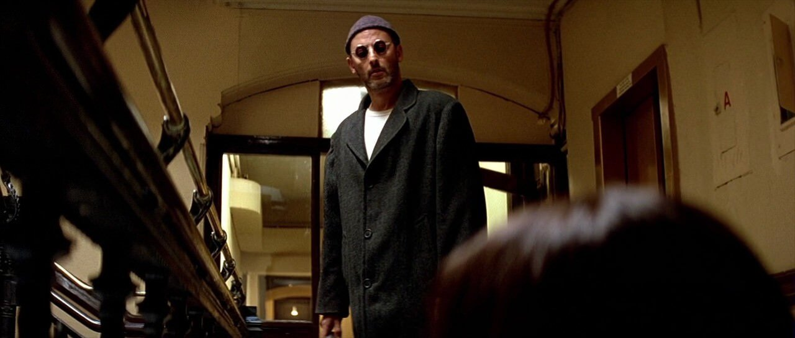
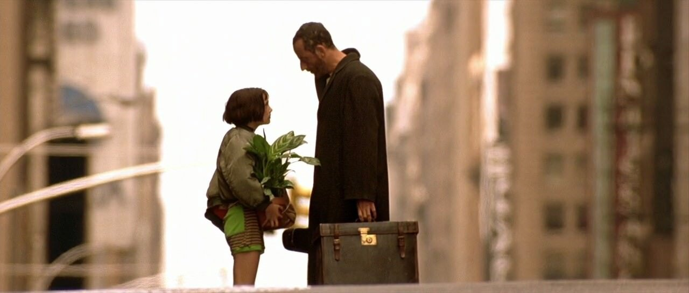
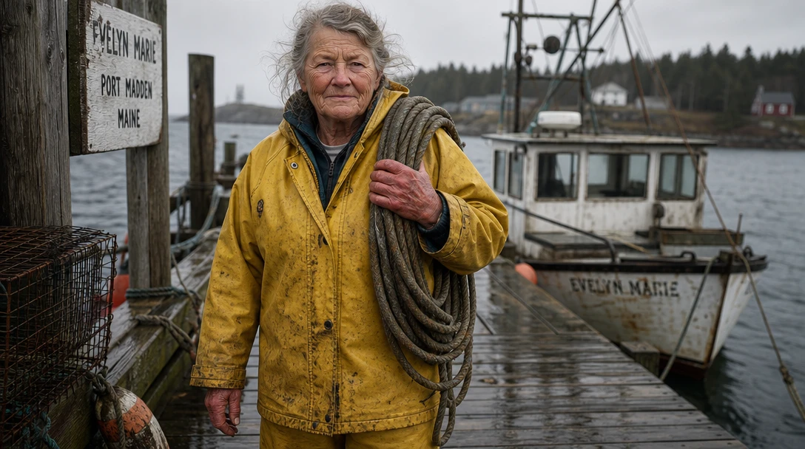
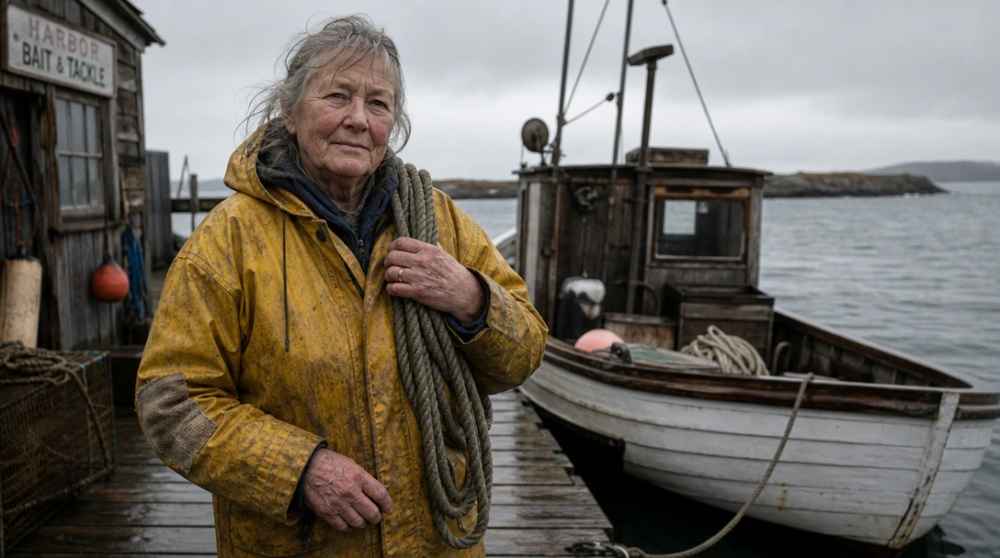
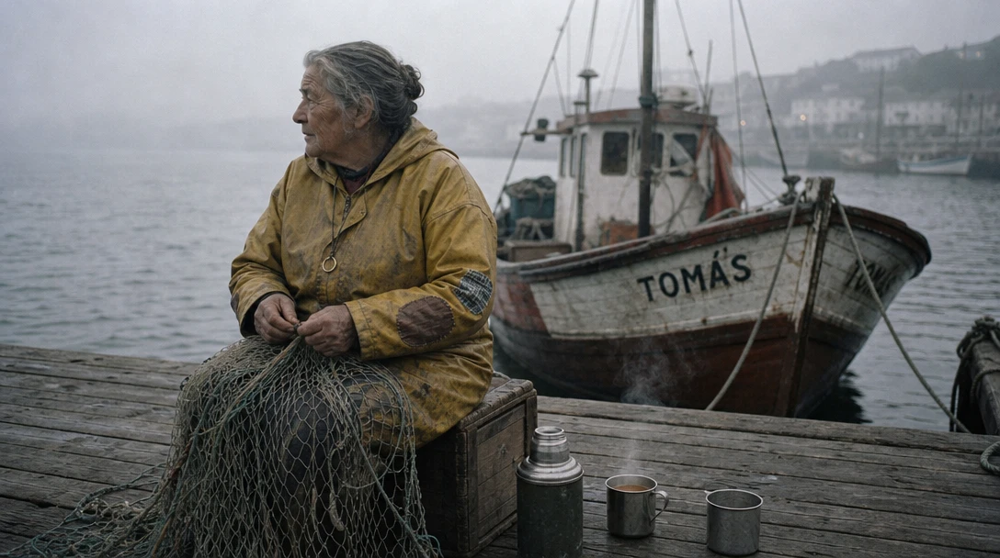

# Someone, not anyone



A man in a hallway. A knit cap, small round dark glasses, a long coat that hangs to his knees. He hasn't said a word yet, and you already know a lot about him: he doesn't want to be seen, and he's not someone you want to cross.

Then there's this:



A girl holding a potted houseplant, and the same man next to her with a suitcase. In the film, the plant goes everywhere with him. A killer who takes care of a houseplant. That one detail tells you he has a soft side, and that he never stays anywhere for long.

**Specific beats adjectives.** "A mysterious man" gives you nothing to see. A cap, round glasses and a plant give you a person.

<!-- Check on rewatch: describe the plant only as the film shows it. -->

Let's make someone.

## Four steps, one person

Click the image to step through, or pick a frame below. Only the prompt changes.

::::ladder
:::step{label="Default"}
```prompt
A woman standing on a pier.
```


:::

:::step{label="Adjectives"}
```prompt
A beautiful, mysterious, wise old woman with an interesting face, standing on a pier.
```


:::

:::step{label="Details"}
```prompt
A 70-year-old fisherwoman standing on a wooden pier, in a yellow oilskin coat and rubber boots, a coil of wet rope over her shoulder, her hands red and cracked from salt and cold.
```


:::

:::step{label="History"}
```prompt
A 70-year-old fisherwoman standing on a wooden pier, in a yellow oilskin coat and rubber boots, a coil of wet rope over her shoulder, her hands red and cracked from salt and cold. The coat is patched at both elbows with mismatched fabric, a thin gold wedding ring is worn almost flat on her finger, and her small wooden boat is tied up behind her.
```


:::
::::

:goto[00 Default]{step=0} We said "a woman", and the AI gave us the one it always gives: young, pretty, smiling over her shoulder. Not a person. An average of a million stock photos.

:goto[01 Adjectives]{step=1} We asked for "beautiful, mysterious, wise, interesting". The AI had to guess what those mean, so it reached for the cliché: a long-haired old woman with beads and a cloak, a lantern, a ghost ship. She's a fortune teller from a fantasy poster. Adjectives tell the AI how *you* want to feel, and it fills in the rest with the most common picture it knows.

:goto[02 Details]{step=2} Now we say what's actually there: her age, her job, her coat, the rope, her hands. No adjectives at all, and she's real. You can guess her morning, her weather, her work.

:goto[03 History]{step=3} Three more details, and each one hints at time: patches on the elbows (she mends, she doesn't replace), a ring worn almost flat (decades of marriage, or decades since), her own small boat. You start wondering about her story.

Two terms to keep:

- **Concrete details**: things you could point at in the picture. "Cracked hands", not "hardworking".
- **Details with a history**: details that show time passing. Wear, repairs, old gifts, scars. They make the viewer ask *what happened?*

## When the AI surprises you

Go back to *Details* and look at the sign on the left, and at the bow of the big boat.

We never gave her a name or a place. The AI did: the boat is called *EVELYN MARIE*, and the sign says *Evelyn Marie, Port Madden, Maine*. As soon as she became a specific person, the AI started inventing the rest of her life to match.

That's a good sign. Concrete details pull in more concrete details. But the AI's story might not be yours. If the boat has a name, it should be the one *you* chose. You'll see what we chose below.

## Your turn

Pick someone ordinary: a bus driver, a night-shift nurse, a boy selling lemonade, a mail carrier.

1. **Intent first.** In one line, what's their story? *"She's done this every day for fifty years."* *"His first day."*
2. **Prompt it.** Start with the default. Then write three adjectives and see what you get. Then delete them and describe only what you could point at.
3. **Add one detail with a history**: something worn, repaired, or kept.

::generator

**Check your result:**
- Could you point at every word of your prompt in the picture?
- Is there anything that only *this* person would have?
- Does one detail make you ask a question about them?

## Director's cut

Every addition serves one idea: *she still goes out every morning, and she still pours two cups.*

```prompt
Film still on 35mm, visible grain, cold grey dawn, thin fog over the harbor. A 70-year-old fisherwoman sits alone on an upturned crate on a wooden pier, mending a fishing net spread across her knees. Yellow oilskin coat patched at both elbows with mismatched fabric, hands red and cracked from salt. She wears her own thin gold wedding ring, and a man's wider ring hangs on a string around her neck. Beside her on the planks: an old thermos and two tin cups, one filled and steaming, the other clean and empty. Behind her, her small wooden fishing boat, a man's name hand-painted on the bow: TOMÁS. She isn't looking at the camera; she looks out at the sea.
```



What each addition does:

- **Two cups, one empty.** The whole story in one object. Nobody needs to explain it. *(Specific subject)*
- **A man's ring on a string around her neck.** It confirms the story without saying it. *(Specific subject)*
- **The boat is named TOMÁS.** Now the boat has a name, and it's ours. *(Specific subject)*
- **She looks out at the sea, not at us.** She's waiting for something. Looking at the camera would turn her into a portrait. *(Composition)*
- **Cold dawn and fog, 35mm.** Grey, quiet, real. *(Light, Medium)*

## Where this is heading

<!-- TODO: video teaser, image-to-video from media/5-directors-cut.webp. Idea: static camera; her hands keep mending the net; steam rises from the full cup; she pauses, glances at the empty cup, then back at the sea. The fog drifts. Generate after the still is approved. -->

In a still, the details tell the story. In a video, you can choose the moment she glances at the empty cup.

## Try next

- **One detail, a different story**: replace the empty cup with a child's drawing taped to the boat. Who is she now?
- **Specific clothes, not costumes**: a coat with one button missing, shoes resoled twice, a uniform from a job she quit.
- **Specific places too**: not "a harbor", but a harbor with a name. The same rule works on the world around your character.
