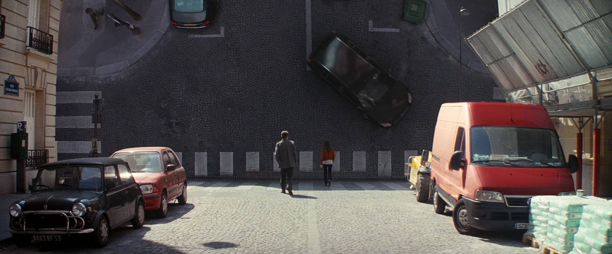
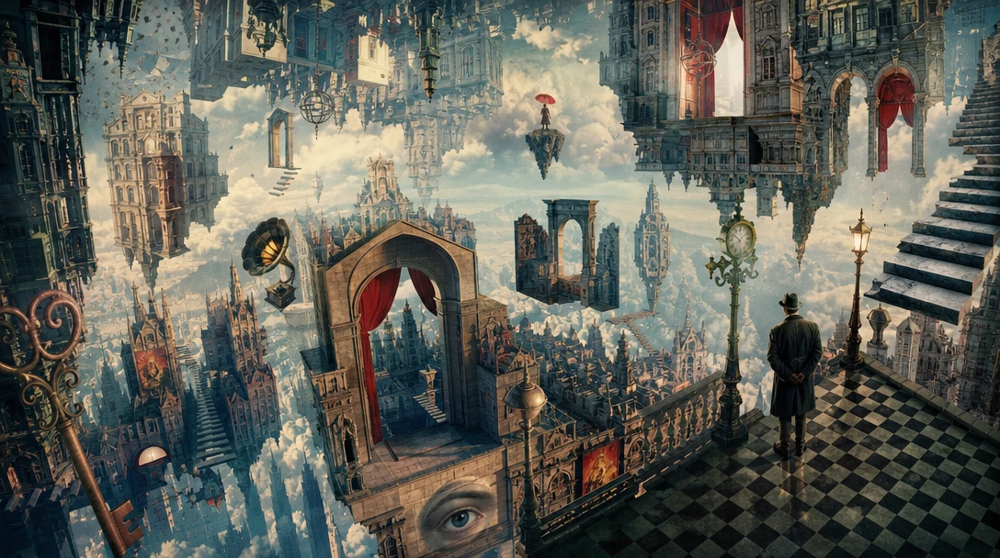
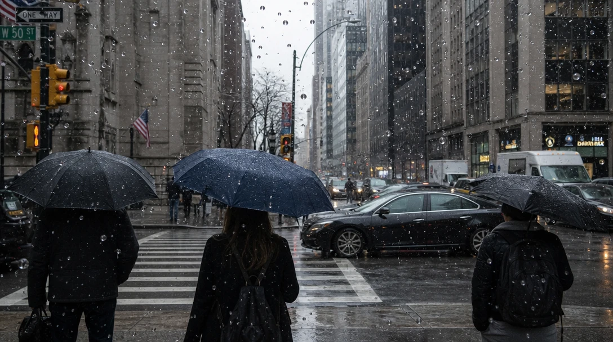
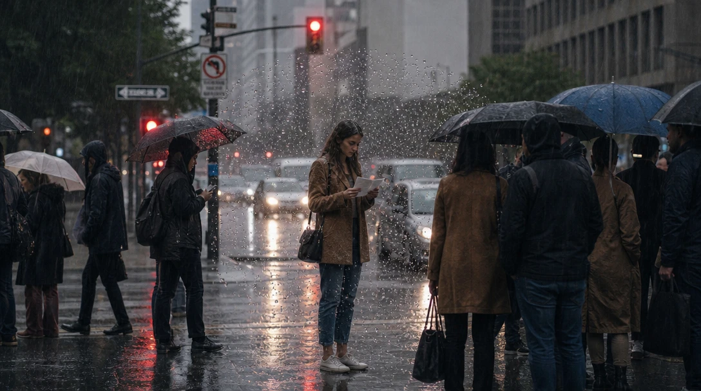
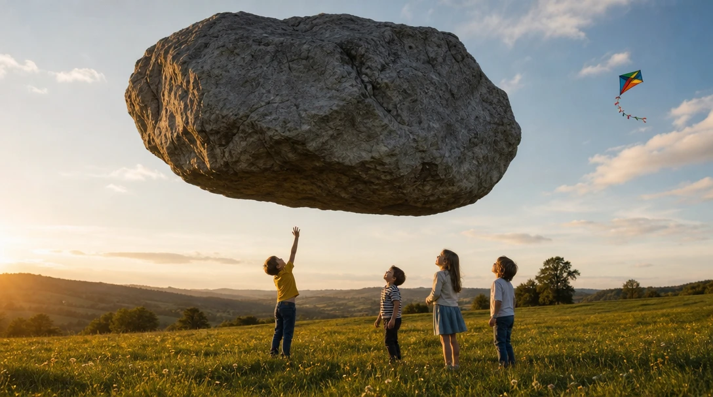
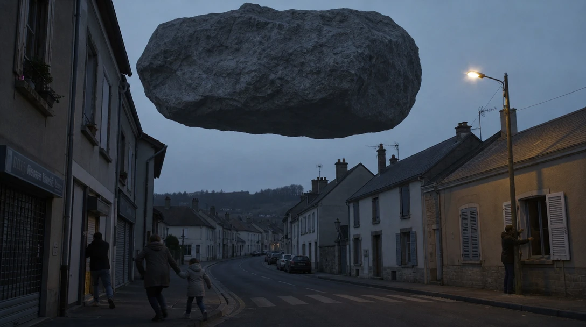
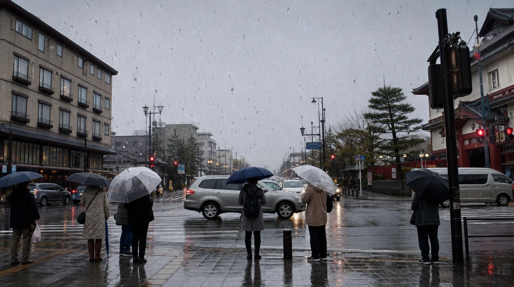
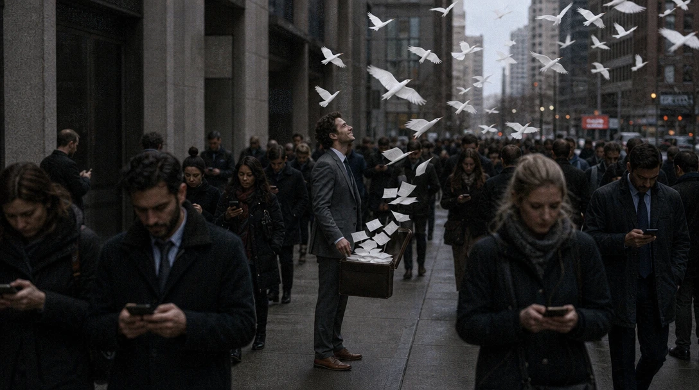

# One wrong thing



Two people cross an ordinary Paris street. Parked cars, a crosswalk, a delivery van. And where the sky should be, there's another street, upside down, with a car parked on it.

Everything in this frame is boring, except one thing. That's why it hits so hard. Your eye checks the cars, the van, the crosswalk, and they're all normal, so the impossible part feels *real*.

**One impossible thing in a real world is stronger than a whole world of them.** And it only works if it means something.

<!-- TODO: René Magritte, Golconda (1953): men in bowler hats hanging in the air over a street. His paintings are under copyright until 2037, so link to it or describe it rather than showing it. Check before going public. -->

The painter René Magritte made a career of this. In *Golconda*, dozens of ordinary men in bowler hats and overcoats hang in the air over a street, like rain. Nothing else is strange. That's what makes it so unsettling.

This is the one thing AI makes almost free. Any impossible image is a sentence away, and that's exactly why most of them are slop: a hundred floating islands that mean nothing. Here, the work is the idea.

## Three steps, one frame

Click the image to step through, or pick a frame below. Only the prompt changes.

::::ladder
:::step{label="Default"}
```prompt
A surreal dreamlike city.
```


:::

:::step{label="One thing"}
```prompt
A realistic photograph of an ordinary city street on a rainy morning: people with umbrellas wait at a crosswalk, cars, wet asphalt, grey sky. Everything is completely normal except one impossible thing: the raindrops hang frozen in mid-air all over the street, motionless, like millions of tiny glass beads.
```


:::

:::step{label="Meaning"}
```prompt
A realistic photograph of an ordinary city street on a rainy morning: people with umbrellas wait at a crosswalk, cars, wet asphalt, grey sky, and the rain pours down on all of them as usual. Everything is completely normal except one impossible thing: in a small circle around one young woman standing still in the middle of the crowd without an umbrella, holding an opened letter, the raindrops hang frozen in mid-air, motionless, like tiny glass beads. Outside that circle, the rain keeps falling.
```


:::
::::

:goto[00 Default]{step=0} "Surreal" and the AI throws in everything: floating castles, stairs into the clouds, a giant eye, a gramophone, red curtains. Each part is impossible, so none of it surprises you. This is what most "surreal AI art" looks like.

:goto[01 One thing]{step=1} A normal, grey morning. People, umbrellas, a crosswalk. Only the rain is wrong: it has stopped in the air. It's striking. But ask yourself: *what does it mean?* Nothing yet. It's a trick.

:goto[02 Meaning]{step=2} Now the rain still falls on everyone, except around one woman holding a letter. For her, and only for her, time has stopped. We don't know what the letter says. We know her world just changed, and nobody around her noticed.

Same impossible idea, but now it's *about* someone. That's the whole difference.

Two terms to keep:

- **Grounded surrealism**: a realistic world with one impossible element. The realism makes the impossible believable.
- **A metaphor you can see**: the impossible thing shows a feeling. Time stopping = a moment you'll never forget.

## Same rock, different story

Same impossible thing: a boulder the size of a house, floating in the air. We changed the place, the light, and how people react.

::::ladder
:::step{label="Wonder"}
```prompt
A realistic photograph: a huge grey boulder, the size of a house, floats motionless a few meters above a green meadow at golden hour. Children stand below it, laughing and pointing up, one of them reaching out a hand. Warm sunlight, wildflowers, a kite in the sky.
```


:::

:::step{label="Dread"}
```prompt
A realistic photograph: a huge grey boulder, the size of a house, floats motionless above the roofs of a small town at dusk. Its shadow falls across the houses. People hurry indoors, a woman pulls a child by the hand, shutters are being closed. Cold blue light, a single streetlight flickering on.
```


:::
::::

In the meadow, it's a miracle. Over the town, it's a threat. The rock didn't change at all.

**The impossible thing sets how strange the world is. The people in it decide what it means.** Watch where they look and what they do: reaching up, or running inside.

## When the AI surprises you

Our first idea for step 2 was different: *the rain falls upward*, from the street back into the sky. Here's what we got:



Just a rainy street. The AI wasn't wrong, exactly. In a single photo, rain falling *up* looks the same as rain falling down. Drops are drops. You can't see direction in a still.

So we changed the idea, not the prompt: rain that *stops* is visible in a still. **An impossible thing only works if you can see that it's impossible.** In a video, our upward rain would have worked.

## Your turn

Pick an ordinary moment: a kitchen in the morning, a bus stop, an office at 5 p.m., a school hallway.

1. **Intent first.** What feeling do you want to show? *"She can't breathe."* *"He finally feels free."* *"Time stopped."*
2. **Prompt it.** First make the scene completely real and ordinary. Then add *one* impossible thing that shows that feeling.
3. **Test it**: tell someone what the impossible thing means in one sentence. If you can't, change the thing, not the prompt.

::generator

**Check your result:**
- How many impossible things are there? If more than one, which one can you remove?
- Is everything else completely real? Does the realism make the impossible part more believable?
- Can you say in one sentence what the impossible thing means?

## Director's cut

Every addition serves one idea: *the moment he lets go of a life he never wanted.*

```prompt
Film still on 35mm, visible grain, overcast morning. A dense crowd of commuters in dark coats hurries along a city sidewalk, heads down, looking at their phones. In the middle, one man in a grey suit has stopped walking. His briefcase hangs open at his side, and the sheets of paper inside are turning into white birds as they rise: near the case they are still flat pages, higher up they grow wings, and above the crowd they fly away as a flock. He watches them go with a small smile. No one else looks up.
```



What each addition does:

- **Pages turning into birds, step by step.** Flat near the case, winged higher up. You see the change happen, so it reads as a transformation, not a random flock. *(The impossible)*
- **A crowd staring at their phones.** Everyone else is still inside the routine. *(Composition: one against many, like lesson 1)*
- **He's the only one looking up.** The gaze tells you who the story is about. *(Specific subject)*
- **A small smile.** Not shock, not fear. Relief. That's what tells you it's freedom. *(Specific subject)*
- **35mm, overcast.** Grey and real, so the birds are the only thing that isn't. *(Medium, Light)*

Remember the empty birdcage in lesson 1? This is where the bird went.

## Where this is heading

<!-- TODO: video teaser, image-to-video from media/5-directors-cut.webp. Idea: the crowd keeps hurrying past; he stands still; the pages lift out of the case one by one, fold into wings and fly up, the flock rising over the street. No one else looks up. Generate after the still is approved. -->

In a still, you see the pages halfway between paper and bird. In a video, you can watch them change. And the impossible things that don't show in a still, like rain falling up, become possible again.

## Try next

- **The everyday made strange**: one ordinary object in the wrong size or material. A tiny house in a teacup, a door made of water.
- **Make it physical**: an impossible thing with real weight and shadows. Does it feel more believable, or more frightening?
- **Put it all together**: take your favorite image from this course, and add one impossible thing that says what it's really about.
